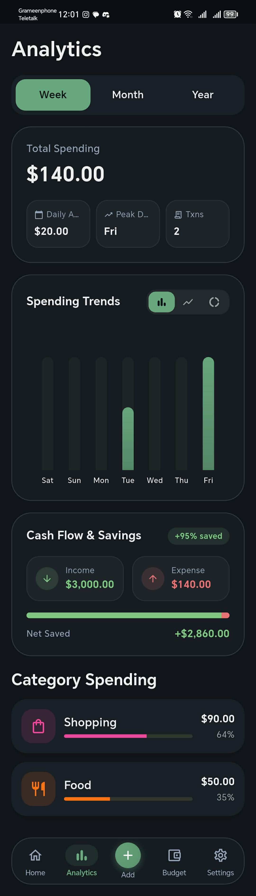
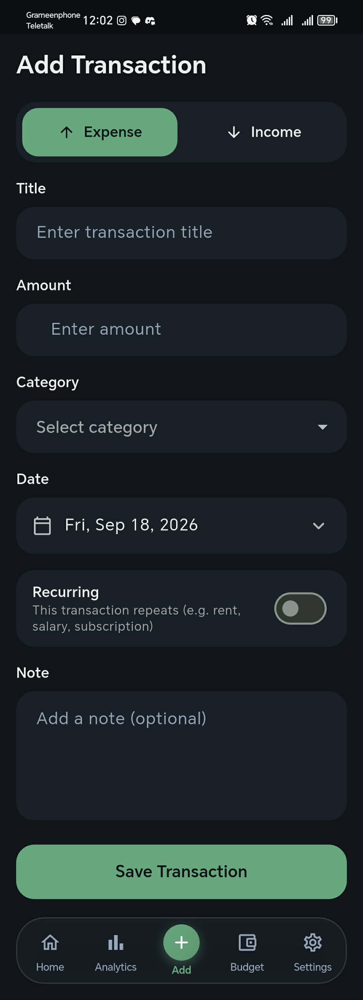
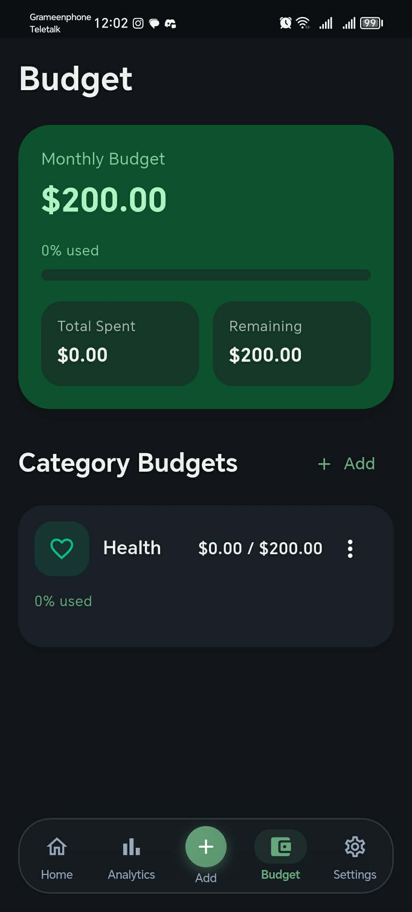
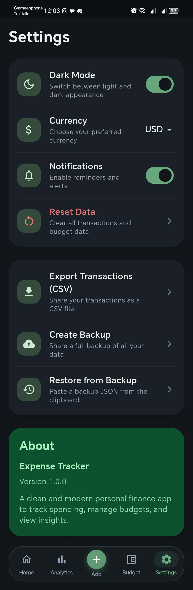
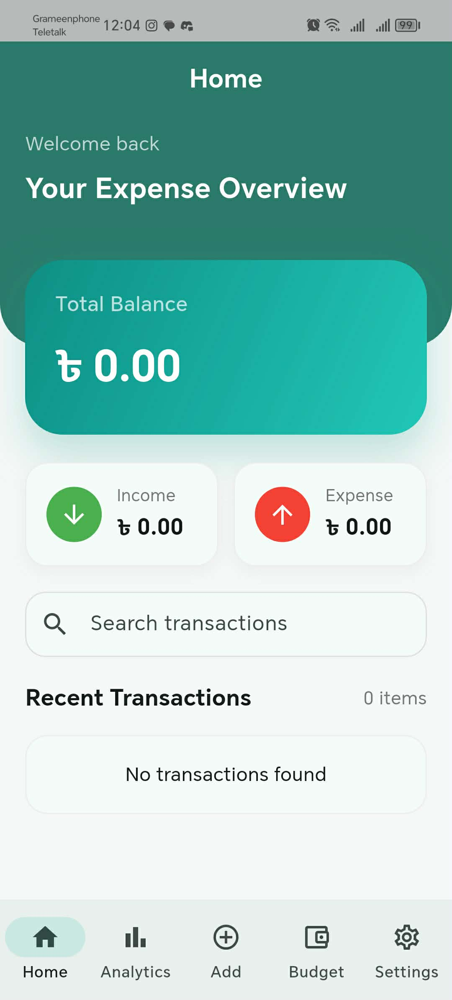
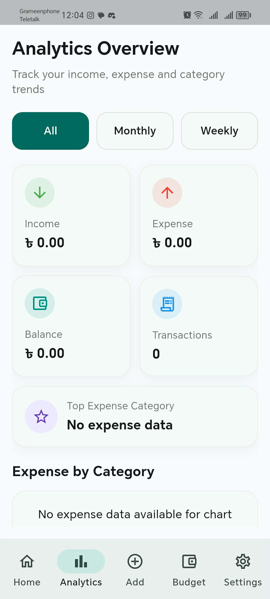
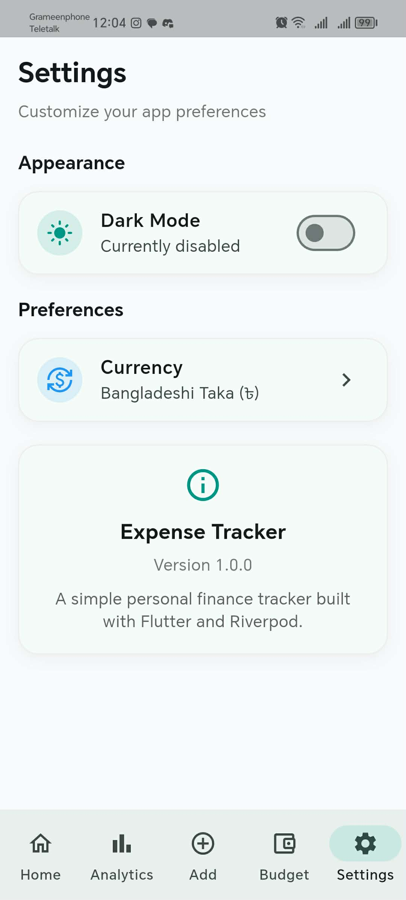

# 🌿 Trackora — Personal Finance & Expense Tracker

<div align="center">


**Trackora** is a sleek, privacy-focused, offline-first personal finance and expense management application built with **Flutter** and **Riverpod**. Designed with a distraction-free **Sage Minimal** aesthetic, it empowers you to track transactions, visualize spending patterns, set category budgets, monitor recurring subscriptions, plan savings goals, and forecast cash flow with complete confidence.

[](https://flutter.dev)
[](https://dart.dev)
[](https://riverpod.dev)
[](#-architecture--design-patterns)
[](https://github.com)
[](https://github.com)
[](LICENSE)

[Features](#-key-features) • [Screenshots](#-screenshots--app-preview) • [Architecture](#-architecture--design-patterns) • [Getting Started](#-getting-started) • [Testing](#-testing--quality-assurance)

</div>

---

## 📱 Screenshots & App Preview

### Dark Mode (Sage Minimal Theme)

| 🏠 Home & Dashboard | 📊 Analytics & Trends | ➕ Add Transaction |
| :---: | :---: | :---: |
|  |  |  |
| *Real-time balance, quick actions, smart insights & recent activity* | *Interactive bar charts, timeframe filters & cash flow savings* | *Intuitive expense/income toggle, category selector & recurring switch* |

<br/>

| 🎯 Budget Management | ⚙️ Settings & Portability |
| :---: | :---: |
|  |  |
| *Monthly budget limits, category breakdown & visual progress* | *Sage dark/light mode, currency selector, CSV export & JSON backup* |

<br/>

### Light Mode Overview

| 🏠 Light Dashboard | 📊 Light Analytics | ⚙️ Light Preferences |
| :---: | :---: | :---: |
|  |  |  |
| *Clean high-contrast daytime dashboard* | *Overview breakdown & category summaries* | *Preference toggles & currency configurations* |

---

## ✨ Key Features

### 1. 📊 Real-Time Financial Dashboard
- **Instant Net Worth & Monthly Metrics:** Displays your total balance alongside dedicated Month Income and Month Expense indicators.
- **Dynamic Transaction Search:** Fast, real-time filtering through historical transactions by title or notes.
- **Proactive Budget Alerts:** Banner alerts trigger automatically when any category hits $\ge 80\%$ or exceeds its budget.
- **Glassmorphic Navigation:** Floating, blur-backed navigation bar with smooth micro-animations.

### 2. 💸 Frictionless Transaction Logging
- **Expense vs. Income:** Quick-toggle transaction type selector.
- **Contextual Categories:** Automatically presents relevant categories (Food, Transport, Shopping, Bills, Health, Entertainment, Education, Salary, Freelance, etc.).
- **Recurring Transactions:** Easily flag repetitive entries such as subscriptions, rent, or monthly payroll.
- **Date & Notes Support:** Date picker with clean formatting and optional contextual notes.

### 3. 🎯 Category & Monthly Budgeting
- **Monthly Limit Gauge:** High-level overview of total budget vs. spent amount and remaining funds.
- **Visual Progress & Color Indicators:** Healthy spending in soothing green, amber warning at $80\%+$, and red alert when exceeded.
- **Category Granularity:** Set, edit, or remove monthly limits per category with one-tap dialogs.

### 4. 📈 In-Depth Analytics & Trends
- **Timeframe Filtering:** Switch between **Week**, **Month**, and **Year** views.
- **Visual Bar Charts:** Powered by `fl_chart` to highlight day-to-day and month-to-month trends.
- **Cash Flow & Savings Metrics:** Tracks your net savings and percentage of income saved over time.
- **Ranked Category Breakdown:** See where your money goes with proportional spend bars.

### 5. 💡 Smart Financial Insights
- **Intelligent Spending Advice:** Automatically detects top expense categories, biggest single expenses, and your no-spend day streaks.
- **Actionable Awareness:** Notifies you of changes in spending velocity and recurring candidate patterns.

### 6. 🔄 Subscriptions & Recurring Charges
- **Automated Detection:** Identifies recurring charges across multiple months or flagged transactions.
- **Cycle Obligations:** Calculates total upcoming recurring liabilities due within the current billing cycle.

### 7. 🏆 Saving Goals Planner
- **Target Tracking:** Track saving goals with target amounts, current progress, and deadlines.
- **Interactive Progress Rings:** Clean percentage visualizer that turns green upon milestone completion.
- **Contribute & Withdraw:** Seamlessly adjust balances with dedicated quick-action dialogs.

### 8. 🔮 90-Day Cash Flow Forecast
- **Forward Projection:** Simulates your balance trajectory 30, 60, and 90 days into the future.
- **Interactive Trajectory Curve:** Visual line graph integrating expected income cycles and recurring subscription costs.

### 9. 🛡️ Data Portability, Backup & Privacy
- **100% Local & Offline:** Your financial data never leaves your device. No cloud account required.
- **CSV Data Export:** Generate clean CSV transaction reports and share them directly via native share sheets.
- **Encrypted JSON Backups:** Export full backups to clipboard and restore with built-in schema validation.
- **Multi-Currency:** Support for **USD ($)**, **BDT (৳)**, **EUR (€)**, **GBP (£)**, and **INR (₹)**.

---

## 🏗️ Architecture & Design Patterns

Trackora is built adhering to **Clean Architecture** principles and a **feature-first** modular structure:

```
expense_tracker/
├── lib/
│   ├── main.dart                                  # Async storage initialization & app bootstrap
│   ├── app/
│   │   ├── app.dart                               # ExpenseTrackerApp root widget
│   │   ├── router/app_tab_item.dart               # Tab definitions (Home, Analytics, Add, Budget, Settings)
│   │   ├── shell/main_shell.dart                  # Floating glassmorphic tab host
│   │   └── theme/                                 # Sage Minimal light & dark themes
│   │       ├── app_colors.dart
│   │       └── app_text_styles.dart
│   ├── core/
│   │   ├── services/
│   │   │   ├── local_storage_service.dart         # SharedPreferences persistent storage singleton
│   │   │   └── export_service.dart                # CSV generator & JSON backup builder
│   │   └── utils/
│   │       └── app_utils.dart                     # Currency, date formatting & UUID generation
│   ├── features/
│   │   ├── add_transaction/                       # Transaction CRUD & domain repositories
│   │   ├── analytics/                             # fl_chart analytics & range providers
│   │   ├── budget/                                # Budget domain, state & progress computation
│   │   ├── forecast/                              # 90-day cash flow projection engine
│   │   ├── goals/                                 # Savings goals domain, state & dialogs
│   │   ├── home/                                  # Summary cards, search, insights & recents
│   │   ├── insights/                              # Rule-based spending insights engine
│   │   ├── settings/                              # Preferences, theme toggling, CSV/backup actions
│   │   └── subscriptions/                         # Recurring expense detection & tracker
│   └── shared/
│       ├── models/                                # Shared immutable domain models
│       └── widgets/                               # Reusable UI components (NavBar, Cards, Headers)
└── test/
    ├── clean_architecture_repositories_test.dart  # Repository contracts & storage resilience
    ├── storage_test.dart                          # JSON serialization & storage tests
    ├── features_test.dart                         # Business logic, subscriptions, export & goals
    └── widget_test.dart                           # End-to-end UI & interaction tests
```

### State Management Philosophy
- **Riverpod v3 Notifier Pattern:** Strict adherence to modern `Notifier<T>` and `NotifierProvider<NotifierT, T>`. Deprecated `StateNotifier` and legacy provider imports are completely eliminated.
- **Repository Pattern:** State notifiers receive injected domain repositories (`TransactionRepository`, `BudgetRepository`, `GoalRepository`, `SettingsRepository`), decoupling UI and business logic from the underlying storage mechanism.
- **Storage Resilience:** Defensive JSON parsing with fallback protection guarantees that corrupted local records do not crash the app.

---

## 🚀 Getting Started

### Prerequisites
- [Flutter SDK](https://docs.flutter.dev/get-started/install) (`^3.41.0` or compatible)
- [Dart SDK](https://dart.dev/get-dart) (`^3.11.0` or compatible)
- Android Studio / VS Code with Flutter extension
- An Android/iOS device, emulator, or modern web browser

### Installation & Run

1. **Clone the repository:**
   ```bash
   git clone https://github.com/AR-NIHAL/trackora-finance-app.git
   cd trackora-finance-app/expense_tracker
   ```

2. **Install dependencies:**
   ```bash
   flutter pub get
   ```

3. **Run static code analysis:**
   ```bash
   flutter analyze
   ```

4. **Launch the application:**
   ```bash
   # Run on connected device or emulator
   flutter run

   # Or run on Chrome
   flutter run -d chrome
   ```

---

## 🧪 Testing & Quality Assurance

The codebase maintains **100% passing automated test coverage** across domain repositories, storage serialization, feature calculations, and widget UI flows:

```bash
cd expense_tracker
flutter test
```

### Test Suite Breakdown (23 Tests)

| Test Suite | Tests | Description |
| :--- | :---: | :--- |
| [`clean_architecture_repositories_test.dart`](expense_tracker/test/clean_architecture_repositories_test.dart) | **9** | Verifies repository contracts, mock injection, and data resilience against corrupted storage |
| [`features_test.dart`](expense_tracker/test/features_test.dart) | **6** | Validates CSV generation, JSON backup integrity, recurring expense detection, and goal updates |
| [`storage_test.dart`](expense_tracker/test/storage_test.dart) | **4** | Validates JSON model round-trips and SharedPreferences persistence |
| [`widget_test.dart`](expense_tracker/test/widget_test.dart) | **4** | End-to-end UI tests covering balance rendering, tab switching, and transaction creation |

---

## 📦 Tech Stack & Dependencies

| Library | Version | Purpose |
| :--- | :--- | :--- |
| [`flutter_riverpod`](https://pub.dev/packages/flutter_riverpod) | `^3.3.1` | Modern reactive state management & dependency injection |
| [`fl_chart`](https://pub.dev/packages/fl_chart) | `^1.1.0` | Beautiful animated bar charts and projection line graphs |
| [`shared_preferences`](https://pub.dev/packages/shared_preferences) | `^2.5.3` | Lightweight, offline key-value persistent storage |
| [`intl`](https://pub.dev/packages/intl) | `^0.20.2` | Multi-currency formatting and date localization |
| [`share_plus`](https://pub.dev/packages/share_plus) | `^12.0.1` | Native mobile & desktop sharing for CSV and backup files |
| [`flutter_lints`](https://pub.dev/packages/flutter_lints) | `^6.0.0` | Strict Dart & Flutter code style enforcement |

---

## 📄 License

This project is licensed under the MIT License — see the [LICENSE](LICENSE) file for details.

---

<div align="center">
  <sub>Crafted with precision using Flutter & Riverpod.</sub>
</div>