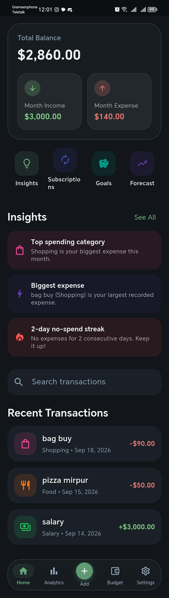

# 🌿 Trackora — Expense Tracker (Flutter App)

<div align="center">



### Offline-First Personal Finance & Expense Tracker Built with Flutter & Riverpod

[](https://flutter.dev)
[](https://dart.dev)
[](https://riverpod.dev)
[](#testing)
[](#linting)

</div>

For the complete project overview, feature gallery, and screenshots, please see the [Root Repository README](../README.md).

---

## 🚀 Quick Start

```bash
# Get dependencies
flutter pub get

# Run static analysis (0 warnings)
flutter analyze

# Run all 23 unit, repository, and widget tests
flutter test

# Run app
flutter run
```

---

## 📁 Feature Modules

- **`features/home`**: Dashboard, balance summary, budget alert banner, search, recent transactions.
- **`features/add_transaction`**: Transaction creation (expense/income, recurring toggle, category picker, date picker).
- **`features/budget`**: Monthly budget and per-category budget management with threshold indicators.
- **`features/analytics`**: Week/Month/Year filters, `fl_chart` spending trends, cash flow savings gauge.
- **`features/insights`**: Dynamic smart insights engine (top category, no-spend streaks, largest expense).
- **`features/subscriptions`**: Recurring transaction detector and cycle obligation summary.
- **`features/goals`**: Savings goals with progress rings, contribute & withdraw actions.
- **`features/forecast`**: 90-day cash flow projection line graph.
- **`features/settings`**: Sage Minimal Dark/Light mode, multi-currency support, CSV export & JSON backup.

See [`PROJECT.md`](PROJECT.md) for in-depth architectural and developer documentation.
